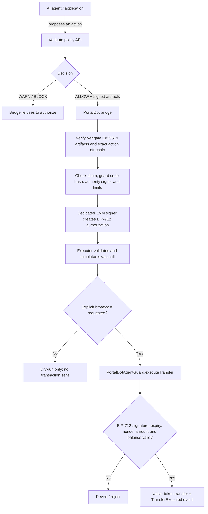

# Verigate PortalDot

Verigate PortalDot is an agent-payment authorization prototype that evaluates an action off-chain, requires a signed `ALLOW` decision, and lets `PortalDotAgentGuard` on PortalDot V3 execute only the exact native-token transfer authorized by a dedicated EVM signer.

**Status:** deployed to the PortalDot V3 EVM testnet; public testnet transfers and local integration tests are documented below. This is a testnet prototype, not an audit, production launch, or mainnet-ready system.

## How it works



### Security boundary

- Verigate makes the off-chain policy decision. The bridge verifies Verigate's Ed25519-signed artifacts and checks that the approved action matches the exact recipient and amount.
- The on-chain guard verifies a separate EIP-712 signature from the configured EVM authority signer. It binds the authorization to the chain, contract, recipient, amount, nonce, deadline and action ID.
- The contract does **not** verify Verigate's Ed25519 signature on-chain. That check belongs to the bridge. The guard is not a global network firewall: it only controls transfers from its own balance and has no arbitrary contract-call function.
- Execution is not automatic by default. The executor's public broadcast path requires the explicit `--broadcast` flag after validation and simulation.

## PortalDot V3 testnet

| Setting | Value |
|---|---|
| Network | PortalDot V3 EVM testnet |
| EVM RPC | `https://test-evm-rpc-v3.portaldot.dev` |
| EVM chain ID | `420420777` |
| Substrate WebSocket RPC | `wss://test-node-v3.portaldot.dev` |
| Recorded Substrate genesis hash | `0xd4f9acbcf7f52388d8b095abe3c198d19fc510e0343e643e87cfbccb155283bd` |
| Node console | [node-console.portaldot.dev](https://node-console.portaldot.dev/) |
| Contract | `PortalDotAgentGuard` |
| Deployed contract address | `0x3f2f484484fbE6e224d058fDfDB6B5A14F09655b` |
| Deployment transaction | `0xb1cf9cca75bb029b0a723f13c398479d2c18704c1138c02c6d92a02c1fcdce3c` |
| Configured authority signer | `0x48F9B07d37b5AF744BA8195c4d6740145b593ea6` |

The deployment record reports a successful receipt at block `116872`, a 2,153-byte runtime and an `authoritySigner()` readback matching the configured signer. See [deployment evidence](docs/deployment-evidence-2026-10-20.md).

### Recorded public transfer evidence

A Verigate-authorized transfer of `0.1` EVM POT is recorded in [the transfer evidence report](docs/authorized-transfer-evidence-2026-10-21-nondust.md):

- Transaction: `0x21acff99d30652161f7e4ba6e1d76e6b6b67e8b9e02b09edd64d8bd7f2d5dd9c`
- Block: `132475`
- Recorded receipt status: `1` (success)
- Recorded event: `TransferExecuted` matched the action ID, recipient and amount
- Recorded guard balance delta: `-0.1` EVM POT

**Historical-RPC limitation:** the configured RPC later stopped returning this old transaction and receipt and reported discarded historical block state. The report preserves the verification performed when the receipt was available; the live dashboard does not substitute saved success for a fresh RPC response. These are single-provider testnet observations, not a second-provider cross-check or independent network authentication.

Node console is the PortalDot node UI; a dedicated EVM explorer deep link is not guaranteed to be available there. The [live DApp](https://rudimentall1.github.io/verigate-portaldot/) reads current RPC state and supports transaction-hash lookup, but an old receipt may be unavailable from the configured endpoint.

## Quick start

Requires Node.js `22.13.0` or newer. The default test and compile commands run locally and do not send public testnet transactions.

```bash
git clone https://github.com/rudimentall1/verigate-portaldot.git
cd verigate-portaldot
npm ci
npm test
npm run compile
```

To check the configured PortalDot endpoints, create a local environment file from the template and run the read-only preflight:

```bash
cp .env.example .env
# Keep the published testnet settings; do not add or commit private keys for a read-only preflight.
npm run preflight
```

Preflight checks the EVM chain ID and separately checks the Substrate endpoint against the pinned genesis hash. A matching response from one RPC is not cryptographic authentication of that endpoint.

## Local Verigate ALLOW/BLOCK integration demo

The reproducible harness `scripts/verigate_local_demo.py` uses a compatible Verigate source checkout and creates a disposable Verigate API/database/issuer plus an isolated loopback Hardhat EVM. It demonstrates a signed `ALLOW` path, a `BLOCK` refusal, bridge verification and a local transfer. It does **not** send that simulated transfer to public PortalDot.

On Windows PowerShell, from this repository, use the Python environment of a compatible Verigate checkout:

```powershell
$verigateRoot = Read-Host "Path to a compatible Verigate checkout"
$python = Join-Path $verigateRoot ".venv\Scripts\python.exe"
& $python ".\scripts\verigate_local_demo.py" --verigate-root $verigateRoot
```

The local integration may require setup of Verigate's dependencies and the selected checkout. The recorded run used Verigate revision `de24e7a02911b5803bac60f799bc1ab37891fec2`. Its local transaction hashes are not PortalDot evidence. See [local E2E verification notes](demo/E2E-LOCAL-VERIFICATION.md).

## Useful commands

| Command | Purpose |
|---|---|
| `npm test` | Run local Hardhat contract / bridge tests |
| `npm run compile` | Compile the Solidity contracts |
| `npm run preflight` | Read-only EVM + Substrate network preflight |
| `npm run monitor:rpc` | Read-only EVM chain ID and latest block check |
| `npm run verify:deployment` | Read current deployed code and authority signer |
| `npm run verify:authorized-transfer -- <TX_HASH>` | Read-only receipt and event verification, when retained by the RPC |
| `npm run bridge:sign -- ./authorization-response.json` | Verify a Verigate response and create a scoped EIP-712 authorization |
| `npm run execute:authorization -- ./signed-authorization.json` | Validate and simulate by default; broadcasting requires the explicit flag described in the CLI help/runbook |

Never commit `.env`, private keys, seed phrases, live issuer secrets or signed authorization payloads.

## Why this matters for PortalDot

PortalDot V3 supports EVM contracts alongside its Substrate runtime. Verigate adds an authorization boundary for applications and autonomous agents that need narrowly scoped EVM-native payments: policy approval stays off-chain, while the deployed guard enforces the approved transfer on-chain. This can serve as a building block for safer agent-powered applications in the ecosystem.

Current scope is deliberately specific: native-token transfers through one EVM guard, plus read-only Substrate runtime/network diagnostics. This repository does not claim a production-ready multichain agent framework, a WASM/EVM cross-execution bridge, universal transaction interception, an independent audit, or mainnet readiness.

## Evidence and presentation

- [Architecture and trust boundaries](docs/architecture.md)
- [Network settings and units](docs/portaldot-v3-network.md)
- [Deployment evidence](docs/deployment-evidence-2026-10-20.md)
- [0.1 EVM POT transfer evidence](docs/authorized-transfer-evidence-2026-10-21-nondust.md)
- [One-base-unit transfer evidence](docs/authorized-transfer-evidence-2026-10-21.md)
- [Three-minute demo plan](docs/demo-script.md)
- [Hacker House checklist](docs/hacker-house-check-in.md)
- [Presentation PDF](docs/Verigate-PortalDot-Presentation.pdf)
- [Live DApp](https://rudimentall1.github.io/verigate-portaldot/)

**Demo recording:** pending. The local ALLOW/BLOCK flow and public testnet transfer are different evidence items; the video should label them clearly and show the public transaction hash only as recorded testnet evidence.
