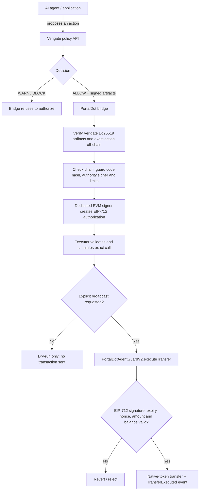

# Verigate PortalDot

Verigate PortalDot is a testnet prototype for policy-gated native-token payments by autonomous agents. Verigate authorizes an action off-chain, the bridge validates the signed authorization and issues a short-lived EIP-712 payload, and the deployed `PortalDotAgentGuardV2` enforces recipient and spending constraints before transferring native POT from the guard's own balance.

**Current execution demo:** V2 is deployed at `0x87C494a5e4B0A8E055F283767579667E10E046C6`. A recorded Verigate `ALLOW` → bridge signing → V2 execution completed a `0.1 POT` transfer in block `149241` and emitted one matching `TransferExecuted` event. The recorded fee was `7.82782148139542551 POT`, much higher than the transfer amount and still requiring a clear explanation. See [V2 live transfer evidence](docs/evidence/portaldot-v2-live-transfer-2026-10-22.json).

V1 remains deployed as the predecessor. The two addresses and their evidence are kept separate below. This is testnet evidence, not an audit, production launch, security guarantee, or mainnet-ready system.

## How it works



### Security boundary

- Verigate makes the off-chain policy decision. The bridge verifies Verigate's Ed25519-signed artifacts and checks that the approved action matches the exact recipient and amount.
- The on-chain guard verifies a separate EIP-712 signature from the configured EVM authority signer. It binds the authorization to the chain, contract, recipient, amount, nonce, deadline and action ID.
- The contract does **not** verify Verigate's Ed25519 signature on-chain. That check belongs to the bridge. The guard is not a global network firewall: it only controls transfers from its own balance and has no arbitrary contract-call function.
- Execution is not automatic by default. The executor's public broadcast path requires the explicit `--broadcast` flag after validation and simulation.

## PortalDot V3 testnet

| Setting | Value |
|---|---|
| Network | PortalDot V3 EVM testnet |
| EVM RPC | `https://test-evm-rpc-v3.portaldot.dev` |
| EVM chain ID | `420420777` |
| Substrate WebSocket RPC | `wss://test-node-v3.portaldot.dev` |
| Recorded Substrate genesis hash | `0xd4f9acbcf7f52388d8b095abe3c198d19fc510e0343e643e87cfbccb155283bd` |
| Node console | [node-console.portaldot.dev](https://node-console.portaldot.dev/) |
| Current contract | `PortalDotAgentGuardV2` |
| Current V2 address | `0x87C494a5e4B0A8E055F283767579667E10E046C6` |
| V2 deployment transaction (recorded) | `0x331c1fc027da51af26ed5ee92ef22a8250fe4efdf0d84526f5fe2203f5d3494b` |
| V2 runtime code hash (recorded) | `0x010a565cad83a33442d0f23f6fcb6f605a76082a5b58434813bedf84c54f0859` |
| Configured authority signer | `0x48F9B07d37b5AF744BA8195c4d6740145b593ea6` |
| Recorded V2 policy | `0.1 POT` per transfer; `0.5 POT` per resettable `3600`-second spending window; one recipient initially allowlisted |

The V2 deployment and configuration record documents the deployed bytecode, authority signer, allowlisted recipient and spend settings. The historical V2 deployment receipt is no longer returned by the configured RPC; the project records prior verification and current code/configuration readbacks separately. See [V2 deployment evidence](docs/evidence/portaldot-v2-deployment-2026-10-22.json) and the [V2 deployment runbook](docs/v2-deployment-runbook.md).

**V1 predecessor:** `PortalDotAgentGuard` at `0x3f2f484484fbE6e224d058fDfDB6B5A14F09655b`, deployed in block `116872` via `0xb1cf9cca75bb029b0a723f13c398479d2c18704c1138c02c6d92a02c1fcdce3c`. V1 does not have V2's recipient allowlist or spending cap.

### V2 live transfer evidence

A recorded Verigate `ALLOW` was followed by bridge authorization and a successful V2 transfer. The receipt and matching event were re-queried through the configured PortalDot RPC by a separate read-only verifier:

- Transaction: `0xaf3df785fdeaf85bbc9af2ae1342a7c664f4a55877469c4996eff2fe90f5551e`
- Block: `149241`
- Contract: `0x87C494a5e4B0A8E055F283767579667E10E046C6`
- Amount: `0.1 POT`
- Receipt status: `1`
- Event: exactly one matching `TransferExecuted`
- Recorded actual fee: `7.82782148139542551 POT`

This is single-provider testnet evidence, not independent authentication of the RPC operator. The recipient balance delta was not measured by the recorded verifier. The cap/allowlist negative cases have local contract-test evidence, not recorded public-chain revert evidence. The configured RPC later stopped returning the historical V2 deployment receipt. Full details: [V2 transfer evidence](docs/evidence/portaldot-v2-live-transfer-2026-10-22.json).

### Earlier V1 public transfer evidence

A Verigate-authorized transfer of `0.1` EVM POT is recorded against the V1 predecessor in [the transfer evidence report](docs/authorized-transfer-evidence-2026-10-21-nondust.md):

- Transaction: `0x21acff99d30652161f7e4ba6e1d76e6b6b67e8b9e02b09edd64d8bd7f2d5dd9c`
- Block: `132475`
- Recorded receipt status: `1` (success)
- Recorded event: `TransferExecuted` matched the action ID, recipient and amount
- Recorded guard balance delta: `-0.1` EVM POT

**Historical-RPC limitation:** the configured RPC later stopped returning this old transaction and receipt and reported discarded historical block state. The report preserves the verification performed when the receipt was available; the live dashboard does not substitute saved success for a fresh RPC response. These are single-provider testnet observations, not a second-provider cross-check or independent network authentication.

Node console is the PortalDot node UI; a dedicated EVM explorer deep link is not guaranteed to be available there. The [live DApp](https://rudimentall1.github.io/verigate-portaldot/) reads current RPC state and supports transaction-hash lookup, but an old receipt may be unavailable from the configured endpoint.

## Quick start

Requires Node.js `22.13.0` or newer. The default test and compile commands run locally and do not send public testnet transactions.

```bash
git clone https://github.com/rudimentall1/verigate-portaldot.git
cd verigate-portaldot
npm ci
npm test
npm run compile
```

To check the configured PortalDot endpoints, create a local environment file from the template and run the read-only preflight:

```bash
cp .env.example .env
# Keep the published testnet settings; do not add or commit private keys for a read-only preflight.
npm run preflight
```

Preflight checks the EVM chain ID and separately checks the Substrate endpoint against the pinned genesis hash. A matching response from one RPC is not cryptographic authentication of that endpoint.

## Local Verigate ALLOW/BLOCK integration demo

The reproducible harness `scripts/verigate_local_demo.py` uses a compatible Verigate source checkout and creates a disposable Verigate API/database/issuer plus an isolated loopback Hardhat EVM. It demonstrates a signed `ALLOW` path, a `BLOCK` refusal, bridge verification and a local transfer. It does **not** send that simulated transfer to public PortalDot.

On Windows PowerShell, from this repository, use the Python environment of a compatible Verigate checkout:

```powershell
$verigateRoot = Read-Host "Path to a compatible Verigate checkout"
$python = Join-Path $verigateRoot ".venv\Scripts\python.exe"
& $python ".\scripts\verigate_local_demo.py" --verigate-root $verigateRoot
```

The local integration may require setup of Verigate's dependencies and the selected checkout. The recorded run used Verigate revision `de24e7a02911b5803bac60f799bc1ab37891fec2`. Its local transaction hashes are not PortalDot evidence. See [local E2E verification notes](demo/E2E-LOCAL-VERIFICATION.md).

## Useful commands

| Command | Purpose |
|---|---|
| `npm test` | Run local Hardhat contract / bridge tests |
| `npm run compile` | Compile the Solidity contracts |
| `npm run preflight` | Read-only EVM + Substrate network preflight |
| `npm run monitor:rpc` | Read-only EVM chain ID and latest block check |
| `npm run verify:deployment` | Read current deployed code and authority signer |
| `npm run verify:authorized-transfer -- <TX_HASH>` | Read-only receipt and event verification, when retained by the RPC |
| `npm run bridge:sign -- ./authorization-response.json` | Verify a Verigate response and create a scoped EIP-712 authorization |
| `npm run execute:authorization -- ./signed-authorization.json` | Validate and simulate by default; broadcasting requires the explicit flag described in the CLI help/runbook |

Never commit `.env`, private keys, seed phrases, live issuer secrets or signed authorization payloads.

## Why this matters for PortalDot

PortalDot V3 exposes an EVM-compatible execution path alongside its Substrate runtime. Verigate PortalDot uses the EVM path for the guard and reads the Substrate runtime separately for network diagnostics and explorer features. The specific contribution is a reference implementation of an off-chain Verigate authorization followed by a narrowly scoped, signed native-token transfer through a contract guard.

No integration into PortalDot Wallet or DaaS is currently claimed, and no PortalDot team endorsement or external user adoption has been confirmed. This repository does not claim a production-ready multichain agent framework, a WASM/EVM cross-execution bridge, universal transaction interception, an independent audit, or mainnet readiness. The current V2 spending counter resets after its configured interval; it is not a continuously sliding rolling-window algorithm.

## Evidence and presentation

- [Architecture and trust boundaries](docs/architecture.md)
- [Network settings and units](docs/portaldot-v3-network.md)
- [Funding and account-mapping investigation, including the confirmed SubWallet/Pindex/explorer address-association discrepancy](docs/funding-and-account-mapping.md)
- [Deployment evidence](docs/deployment-evidence-2026-10-20.md)
- [0.1 EVM POT transfer evidence](docs/authorized-transfer-evidence-2026-10-21-nondust.md)
- [One-base-unit transfer evidence](docs/authorized-transfer-evidence-2026-10-21.md)
- [Three-minute demo plan](docs/demo-script.md)
- [Hacker House checklist](docs/hacker-house-check-in.md)
- [Presentation PDF](docs/Verigate-PortalDot-Presentation.pdf)
- [Live DApp](https://rudimentall1.github.io/verigate-portaldot/)

**Demo recording:** pending. The local ALLOW/BLOCK flow and public testnet transfer are different evidence items; the video should label them clearly and show the public transaction hash only as recorded testnet evidence.
