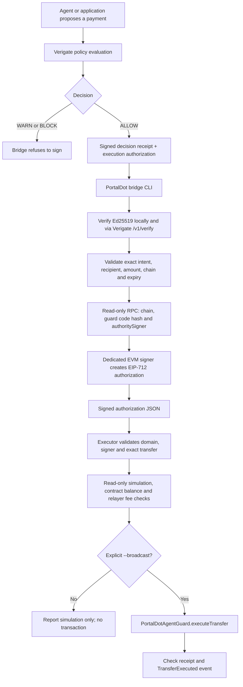

# Architecture and trust boundaries

Updated: 19 October 2026

## Current flow

The executor does not send a transaction by default. The explicit --broadcast path submits the signed transfer only after signature, network, deployed code hash, authority signer, expiry, contract balance, simulation and relayer fee budget checks pass. Automated CI exercises both dry-run and the broadcast path only against a temporary loopback Hardhat EVM, then confirms that recipient balance delta equals the signed amount. This is local integration evidence, not a public PortalDot transaction or deployment.

## What is checked off-chain

- Decision must be exactly ALLOW; WARN and BLOCK are refused.
- Both Ed25519 artifacts are submitted to the configured Verigate /v1/verify endpoint after local verification against a pinned issuer key.
- Receipt intent and authorization action must match by canonical SHA-256 digest.
- Recipient must match the signed PortalDot mapping. Base-unit amounts in amount_exact and both metadata.portaldot_v3.amount_base_units fields must be canonical positive decimal strings; numeric amount fields are rejected instead of being coerced through JavaScript Number.
- Preflight, RPC monitoring and Hardhat network configuration reject RPC URLs with embedded username/password. Read-only JSON-RPC requests disable redirects. Preflight checks JSON-RPC version, response ID, provider errors and canonical hexadecimal quantity format.
- The bridge authorization must match the expected chain ID and have valid nonce, authorization ID, issue time and expiry.
- Before signing, the bridge verifies chain ID, deployed bytecode, the Keccak runtime-code hash pinned in PORTALDOT_GUARD_CODE_HASH, and on-chain authoritySigner().
- The executor revalidates EIP-712 domain, recovered authority signer, contract, canonical transfer values and deadline immediately before any simulation or broadcast.
- A separate read-only Substrate probe decoded the live V3 Revive metadata at reported runtime specVersion 3002. It found Revive.OriginalAccount as H160 -> AccountId32, confirmed Revive.AddressSuffix is absent, and read AutoMap=true and native/EVM unit and deposit constants. The specific registered-wallet H160 mapping remains a separate read-only single-key lookup, not inferred from offline derivation.

## What the contract enforces

- EIP-712 domain binds the signature to chain ID and contract address.
- Signature binds recipient, amount, nonce, deadline and action ID.
- Expired signatures, reused nonces, zero recipients, zero amounts, self-transfers, insufficient balance and invalid signatures are rejected.
- A reentrancy guard protects the external value transfer.
- The contract has no generic arbitrary-call function.

## Trust boundary

The contract does not verify Verigate's Ed25519 signatures. The bridge verifies those through the configured Verigate instance, then uses a separate EVM key to produce an EIP-712 signature. The executor relays that exact signed payload. The EVM contract trusts the bridge signer. Protecting the Verigate API and bridge key is part of the security model; the relayer key should be separate from the authority signer.

## Deployment blocker

The project has read-only evidence that the advertised Substrate endpoint reports chain name PortaldotV3 Test and runtime specName portaldot-v3 / specVersion 3002, with Revive.ChainId=420420777. The advertised EVM RPC has also responded with chain ID 420420777. These observations establish consistency of reported parameters, but one endpoint cannot cryptographically authenticate itself. Independently confirm the endpoint/runtime before any public transaction, and locally query Revive.OriginalAccount for the exact H160 to be used. No live PortalDot contract deployment is claimed.

## Validation evidence

The [151-test run](https://github.com/rudimentall1/verigate-portaldot/actions/runs/39223695565) and [PortalDot integration run](https://github.com/rudimentall1/verigate-portaldot/actions/runs/39223695574) passed on revision 6dfc78a, including the one-key mapping verifier's runtime fingerprint and mocked command flow. The isolated harness uses disposable Verigate state and a loopback-only Hardhat EVM: it issues ALLOW and BLOCK, signs only ALLOW, checks executor dry-run leaves state unchanged, then executes that exact signed transfer locally and checks the event and exact recipient balance delta. No public PortalDot transaction is used by that integration flow.

The sanitized runtime observation is committed in evidence/portaldot-v3-runtime-2026-10-19.json. It records a synthetic-key query only; it contains no user wallet pair.
