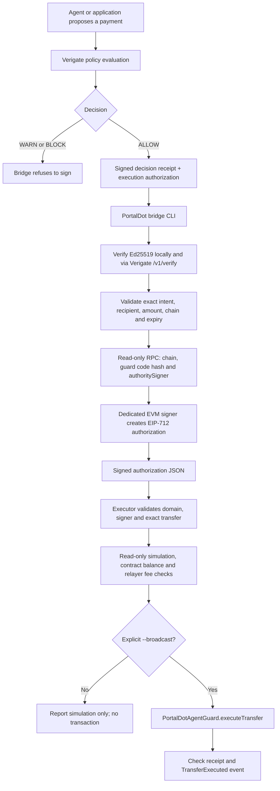

# Architecture and trust boundaries

Updated: 27 October 2026

## Current flow

The executor does not send a transaction by default. The explicit `--broadcast` path submits the signed transfer only after signature, network, deployed code hash, authority signer, expiry, contract balance, simulation and relayer fee budget checks pass. Automated CI exercises dry-run and the broadcast path only against a temporary loopback Hardhat EVM, then confirms that recipient balance delta equals the signed amount. This is local integration evidence, not a public PortalDot transfer or deployment.

## What is checked off-chain

- Decision must be exactly ALLOW; WARN and BLOCK are refused.
- Both Ed25519 artifacts are submitted to the configured Verigate `/v1/verify` endpoint after local verification against a pinned issuer key.
- Receipt intent and authorization action must match by canonical SHA-256 digest.
- Recipient must match the signed PortalDot mapping. Base-unit amounts in `amount_exact` and both `metadata.portaldot_v3.amount_base_units` fields must be canonical positive decimal strings; numeric amount fields are rejected instead of being coerced through JavaScript Number.
- Preflight, RPC monitoring and Hardhat network configuration reject RPC URLs with embedded username/password. Read-only JSON-RPC requests disable redirects. Preflight checks JSON-RPC version, response ID, provider errors and canonical hexadecimal quantity format.
- The bridge authorization must match the expected chain ID and have valid nonce, authorization ID, issue time and expiry.
- Before signing, the bridge verifies chain ID, deployed bytecode, the Keccak runtime-code hash pinned in `PORTALDOT_GUARD_CODE_HASH`, and on-chain `authoritySigner()`.
- The executor revalidates EIP-712 domain, recovered authority signer, contract, canonical transfer values and deadline immediately before any simulation or broadcast.
- A separate read-only Substrate probe decoded the reported V3 Revive metadata at specVersion 3002. It found `Revive.OriginalAccount` as H160 → AccountId32, `Revive.AutoMap=true`, `NativeToEthRatio=10000`, and runtime deposit/gas constants. The specific registered-wallet H160 mapping remains a separate single-key lookup and is not inferred from offline derivation.

## What the contract enforces

- EIP-712 domain binds the signature to chain ID and contract address.
- Signature binds recipient, amount, nonce, deadline and action ID.
- Expired signatures, reused nonces, zero recipients, zero amounts, self-transfers, insufficient balance and invalid signatures are rejected.
- A reentrancy guard protects the external value transfer.
- The contract has no generic arbitrary-call function.

## Trust boundary

The contract does not verify Verigate's Ed25519 signatures. The bridge verifies those through the configured Verigate instance, then uses a separate EVM key to produce an EIP-712 signature. The executor relays that exact signed payload. The EVM contract trusts the bridge signer. Protecting the Verigate API and bridge key is part of the security model; the relayer key should be separate from the authority signer.

## Native Substrate reference adapter (testnet code path)

A separate adapter, documented in [native Substrate authorized transfer](native-substrate-authorized-transfer.md), verifies Verigate's signed `ALLOW` artifacts and exact action binding, checks the pinned Substrate genesis and runtime, estimates fee/balance conditions, and can explicitly submit only `Balances.transfer_keep_alive` to an SS58 recipient on the confirmed testnet. It defaults to read-only preflight; a transfer requires the explicit `--broadcast` flag and a dedicated Substrate signer.

This extends the reference integration beyond EVM-only payments. It is not direct DaaS integration: the DaaS call ABI was not found in the reviewed public material. A native Substrate transfer was broadcast and recorded as finalized on 24 October 2026: the evidence contains a Verigate `ALLOW`, successful pre-broadcast `system_dryRun`, `system.ExtrinsicSuccess`, one matching `balances.Transfer` event for `0.1 POT`, and a `TransactionFeePaid` event. See [the saved native transfer evidence](evidence/portaldot-native-substrate-live-transfer-2026-10-24.json). This evidence was re-queried through one configured RPC and has not been independently verified through a second provider. The adapter's Ed25519 checks happen in the adapter, not inside the Substrate runtime. Its local replay ledger is single-host state and must not be treated as distributed replay protection.

## Testnet deployment status

Two distinct versions are deployed on PortalDot V3 EVM testnet. The current execution demo uses `PortalDotAgentGuardV2` at `0x87C494a5e4B0A8E055F283767579667E10E046C6`. The V2 deployment/configuration record lists runtime hash `0x010a565cad83a33442d0f23f6fcb6f605a76082a5b58434813bedf84c54f0859`, the configured authority signer, an allowlisted recipient, a `0.1 POT` per-transfer maximum, and a `0.5 POT` cap for a resettable `3600-second` spending interval. The counter resets after the interval expires; it is not a continuously sliding rolling-window sum. The administrator can change recipients and caps.

A fresh Verigate `ALLOW` was followed by bridge signing and a real `0.1 POT` V2 transfer recorded in block `149241`. The saved follow-up verifier reported receipt status `1` and exactly one matching `TransferExecuted` event. The receipt-derived cost figure was `7.82782148139542551 POT` (`gasUsed × effectiveGasPriceWei`). A later read-only check reconciled the sender's total EVM-balance decrease from `416.196502092920504516` to `408.368680611525079006 POT` in block 149241, which contained only the target transaction. The decrease matched `gasUsed × effectiveGasPriceWei` exactly. This was a single-RPC check; it does not split execution-fee and storage-deposit components. Evidence: [V2 live transfer](evidence/portaldot-v2-live-transfer-2026-10-22.json).

The receipt, transaction block and sender balance reads were queried through the configured PortalDot RPC, not a second EVM provider. The sender's balance delta was reconciled; the recipient balance delta was later measured through the same RPC, increasing from `0` to `0.1 POT` across the isolated block. The historical V2 deployment receipt later became unavailable through this RPC, while separate code/configuration readbacks were reported successful. The earlier V1 contract remains deployed at `0x3f2f484484fbE6e224d058fDfDB6B5A14F09655b`. V1 does not enforce V2's recipient allowlist or spend cap. These are testnet observations, not independent network authentication, a security audit, or production-readiness evidence.
## Live read-only enforcement probes (24 October 2026)

The published DApp browser smoke test checked EVM chain ID `420420777`, the recorded V2 runtime Keccak hash, signer and policy values, then called the deployed V2 contract with `eth_call`:

- An unlisted recipient returned `InvalidRecipient()`.
- A request for `0.100000000000000001 POT` against the live `0.1 POT` per-transfer cap returned `AmountExceedsCap(amount, cap)` with matching amount/cap arguments.
- Both results came from one configured RPC and were obtained without signing or broadcasting a transaction. They are not mined public-chain reverts and do not establish that Verigate returned BLOCK for those exact probe inputs.
- The same browser run queried the known V2 transfer hash and matched receipt status `1`, block `149241`, and one `TransferExecuted` event with expected action ID, recipient and amount.

The complete report is committed at [published-dapp-browser-smoke-2026-10-24.json](evidence/published-dapp-browser-smoke-2026-10-24.json); browser workflow [40071558856](https://github.com/rudimentall1/verigate-portaldot/actions/runs/40071558856) passed.

## Validation evidence

- On the 24 October main revision before the generated PDF commit, [Test](https://github.com/rudimentall1/verigate-portaldot/actions/runs/40072816973), [PortalDot CI](https://github.com/rudimentall1/verigate-portaldot/actions/runs/40072817020) and [PortalDot RPC health](https://github.com/rudimentall1/verigate-portaldot/actions/runs/40072816999) passed. CI reported 178 passing Mocha tests; Explorer, DApp/receipt lookup, network-readiness, Substrate-adapter, receipt-quorum and RPC-monitor suites passed, as did the isolated Verigate ALLOW/BLOCK integration.
- The compile step reported `No contracts to compile`; that line alone is not evidence of an independent fresh Solidity compilation.
- The reproducible seven-slide deck was rebuilt, rendered to seven PNG pages and passed PDF validation in presentation workflow [40072817001](https://github.com/rudimentall1/verigate-portaldot/actions/runs/40072817001).
- The isolated Verigate integration returns ALLOW and BLOCK from a temporary API, verifies Ed25519 signatures, refuses BLOCK, then executes the exact ALLOW transfer against the real guard source on a loopback Hardhat EVM. It is local end-to-end evidence, not a public PortalDot transaction.
