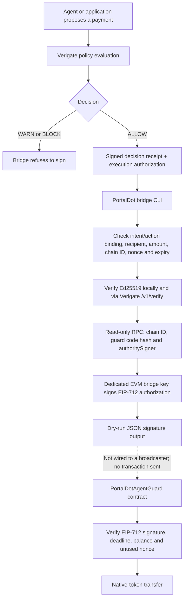

# Architecture and trust boundaries

Updated: 19 October 2026

## Current flow

The bridge CLI still stops at signed JSON output; it does not submit live transactions. CI now deploys the actual guard source to a temporary loopback Hardhat EVM and verifies the bridge's pre-sign checks there. The public PortalDot EVM endpoint and any live contract deployment have not been independently verified; the dotted line is not a public-network path.

## What is checked off-chain

- Decision must be exactly `ALLOW`; `WARN` and `BLOCK` are refused.
- Both Ed25519 artifacts are submitted to the configured Verigate `/v1/verify` endpoint.
- Receipt intent and authorization action must match by canonical SHA-256 digest.
- Recipient must match the signed PortalDot mapping. Base-unit amounts in `amount_exact` and both `metadata.portaldot_v3.amount_base_units` fields must be canonical positive decimal strings; numeric amount fields are rejected instead of being coerced through JavaScript `Number`, which can lose precision above `Number.MAX_SAFE_INTEGER`.
- Preflight, RPC monitoring, and Hardhat network configuration reject RPC URLs with embedded username/password. Read-only JSON-RPC requests disable redirects, so a configured endpoint cannot silently redirect to another destination.
- The authorization must match the expected chain ID and have a valid nonce, authorization ID, issue time and expiry.
- The bridge signer key must match the configured contract authority signer.
- Before signing, the bridge uses read-only RPC calls to verify chain ID, deployed bytecode, the Keccak runtime-code hash pinned in `PORTALDOT_GUARD_CODE_HASH`, and on-chain `authoritySigner()`.

## What the contract enforces

- EIP-712 domain binds the signature to the chain ID and contract address.
- Signature binds recipient, amount, nonce, deadline and action ID.
- Expired signatures, reused nonces, zero recipients, zero amounts, self-transfers, insufficient balance and invalid signatures are rejected.
- A reentrancy guard protects the external value transfer.
- The contract has no generic arbitrary-call function.

## Trust boundary

The contract does **not** verify Verigate's Ed25519 signatures. The bridge verifies those through the configured Verigate instance, then uses a separate EVM key to produce an EIP-712 signature. The EVM contract trusts that bridge signer. Protecting the Verigate API and bridge key is therefore part of the security model.

## Deployment blocker

On 17 October 2026, the PortalDot team announced the updated V3 testnet EVM RPC `https://test-evm-rpc-v3.portaldot.dev` and chain ID `420420777`. These values are recorded in `.env.example` from that announcement. Run preflight to verify the endpoint responds and reports the expected chain ID before deployment. The announcement separately lists the Substrate node WebSocket `wss://test-node-v3.portaldot.dev` and explorer `https://node-console.portaldot.dev`; neither is the EVM JSON-RPC endpoint. Confirm token denomination and native/EVM wallet mapping before using testnet funds.

## Validation evidence

The migrated branch passed [98 tests and Solidity compilation](https://github.com/rudimentall1/verigate-portaldot/actions/runs/39197305884) and [PortalDot CI, including the isolated integration, deploy-network smoke, and credentialed-RPC rejection checks](https://github.com/rudimentall1/verigate-portaldot/actions/runs/39197305832) on code commit `d8d2ec1a7b6b6cf291890098f25a0c285771d1d3`. Regression tests cover numeric transfer amounts/base-unit mappings, RPC URL credentials, and redirect disabling. Integration uses a temporary Verigate API and loopback Hardhat EVM with disposable issuer, deployer and bridge keys. It exercises ALLOW/BLOCK through real HTTP routes, deploys the actual guard source to the simulator, checks runtime-code hash and authority before signing ALLOW, and refuses BLOCK. Deployment/funding transactions stay on the local simulator; no public PortalDot RPC is contacted. This is not live deployment evidence.
