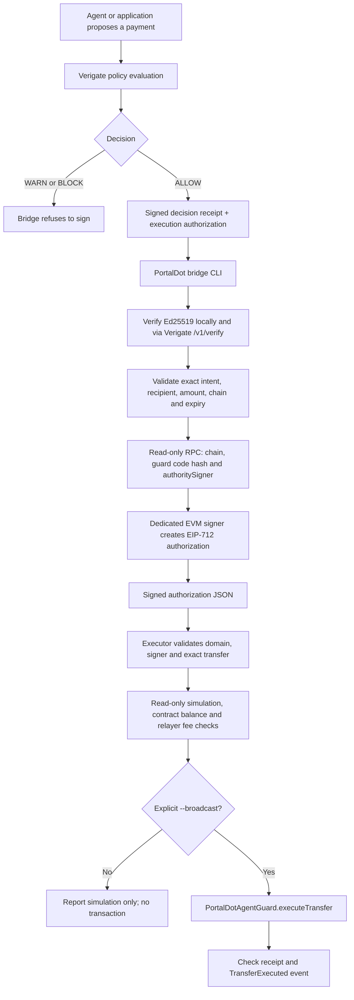

# Architecture and trust boundaries

Updated: 20 October 2026

## Current flow

The executor does not send a transaction by default. The explicit `--broadcast` path submits the signed transfer only after signature, network, deployed code hash, authority signer, expiry, contract balance, simulation and relayer fee budget checks pass. Automated CI exercises dry-run and the broadcast path only against a temporary loopback Hardhat EVM, then confirms that recipient balance delta equals the signed amount. This is local integration evidence, not a public PortalDot transfer or deployment.

## What is checked off-chain

- Decision must be exactly ALLOW; WARN and BLOCK are refused.
- Both Ed25519 artifacts are submitted to the configured Verigate `/v1/verify` endpoint after local verification against a pinned issuer key.
- Receipt intent and authorization action must match by canonical SHA-256 digest.
- Recipient must match the signed PortalDot mapping. Base-unit amounts in `amount_exact` and both `metadata.portaldot_v3.amount_base_units` fields must be canonical positive decimal strings; numeric amount fields are rejected instead of being coerced through JavaScript Number.
- Preflight, RPC monitoring and Hardhat network configuration reject RPC URLs with embedded username/password. Read-only JSON-RPC requests disable redirects. Preflight checks JSON-RPC version, response ID, provider errors and canonical hexadecimal quantity format.
- The bridge authorization must match the expected chain ID and have valid nonce, authorization ID, issue time and expiry.
- Before signing, the bridge verifies chain ID, deployed bytecode, the Keccak runtime-code hash pinned in `PORTALDOT_GUARD_CODE_HASH`, and on-chain `authoritySigner()`.
- The executor revalidates EIP-712 domain, recovered authority signer, contract, canonical transfer values and deadline immediately before any simulation or broadcast.
- A separate read-only Substrate probe decoded the reported V3 Revive metadata at specVersion 3002. It found `Revive.OriginalAccount` as H160 → AccountId32, `Revive.AutoMap=true`, `NativeToEthRatio=10000`, and runtime deposit/gas constants. The specific registered-wallet H160 mapping remains a separate single-key lookup and is not inferred from offline derivation.

## What the contract enforces

- EIP-712 domain binds the signature to chain ID and contract address.
- Signature binds recipient, amount, nonce, deadline and action ID.
- Expired signatures, reused nonces, zero recipients, zero amounts, self-transfers, insufficient balance and invalid signatures are rejected.
- A reentrancy guard protects the external value transfer.
- The contract has no generic arbitrary-call function.

## Trust boundary

The contract does not verify Verigate's Ed25519 signatures. The bridge verifies those through the configured Verigate instance, then uses a separate EVM key to produce an EIP-712 signature. The executor relays that exact signed payload. The EVM contract trusts the bridge signer. Protecting the Verigate API and bridge key is part of the security model; the relayer key should be separate from the authority signer.

## Testnet deployment status

Two distinct versions are deployed on PortalDot V3 EVM testnet. The current execution demo uses `PortalDotAgentGuardV2` at `0x87C494a5e4B0A8E055F283767579667E10E046C6`. The V2 deployment/configuration record lists runtime hash `0x010a565cad83a33442d0f23f6fcb6f605a76082a5b58434813bedf84c54f0859`, the configured authority signer, an allowlisted recipient, a `0.1 POT` per-transfer maximum, and a `0.5 POT` cap for a resettable `3600-second` spending interval. The counter resets after the interval expires; it is not a continuously sliding rolling-window sum. The administrator can change recipients and caps.

A fresh Verigate `ALLOW` was followed by bridge signing and a real `0.1 POT` V2 transfer recorded in block `149241`. The saved follow-up verifier reported receipt status `1` and exactly one matching `TransferExecuted` event. The receipt-derived cost figure was `7.82782148139542551 POT` (`gasUsed × effectiveGasPriceWei`). The relayer balance delta and the runtime fee/storage-deposit breakdown were not recorded, so this value has not been independently reconciled as an execution fee. Evidence: [V2 live transfer](evidence/portaldot-v2-live-transfer-2026-10-22.json).

Verification was performed through the configured PortalDot RPC, not a second EVM provider; the recipient balance delta was not measured by the reported verifier. The historical V2 deployment receipt later became unavailable through this RPC, while separate code/configuration readbacks were reported successful. The earlier V1 contract remains deployed at `0x3f2f484484fbE6e224d058fDfDB6B5A14F09655b`. V1 does not enforce V2's recipient allowlist or spend cap. These are testnet observations, not independent network authentication, a security audit, or production-readiness evidence.
## Validation evidence

- 156 tests passed in the local deployment workspace on 20 October 2026.
- Network preflight confirmed the expected EVM chain ID and configured Substrate genesis pin; the RPC monitor reported healthy at the last recorded check.
- The isolated Verigate integration returned ALLOW and BLOCK from a temporary API, verified Ed25519 signatures, refused BLOCK, passed dry-run without state changes, then executed the exact ALLOW transfer against the real guard source on a loopback Hardhat EVM.
- The published `main` commit `f5aee87126a87c3ca02a72ba7e7896c40d09ee55` has successful GitHub Actions runs for tests, the isolated Verigate integration, dependency audit, PortalDot RPC health, PortalDot CI, and Substrate runtime metadata. The local workspace also reports 156 tests passing. See the linked workflow runs in `docs/hacker-house-check-in.md`.

The isolated EVM is configured with chain ID 420420777 for EIP-712 domain testing. This configuration does not turn the local EVM into PortalDot testnet. No transaction from the local end-to-end test was sent to a public PortalDot RPC.