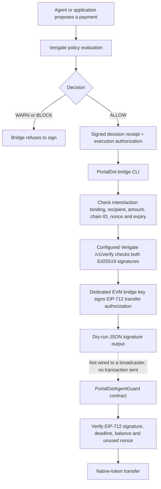

# Architecture and trust boundaries

Updated: 14 October 2026

## Current flow

The bridge CLI currently stops at the signed JSON output. The contract and its local Hardhat tests are in the repository, but the target PortalDot EVM testnet and a live contract deployment have not been independently verified. The dotted line is a future integration step, not a working path.

## What is checked off-chain

- Decision must be exactly `ALLOW`; `WARN` and `BLOCK` are refused.
- Both Ed25519 artifacts are submitted to the configured Verigate `/v1/verify` endpoint.
- Receipt intent and authorization action must match by canonical SHA-256 digest.
- Recipient and amount must match the PortalDot-specific mapping in the signed action.
- The authorization must match the expected chain ID and have a valid nonce, authorization ID, issue time and expiry.
- The bridge signer key must match the configured contract authority signer. The contract address must be explicitly configured.

## What the contract enforces

- EIP-712 domain binds the signature to the chain ID and contract address.
- Signature binds recipient, amount, nonce, deadline and action ID.
- Expired signatures, reused nonces, zero recipients, zero amounts, self-transfers, insufficient balance and invalid signatures are rejected.
- A reentrancy guard protects the external value transfer.
- The contract has no generic arbitrary-call function.

## Trust boundary

The contract does **not** verify Verigate's Ed25519 signatures. The bridge verifies those through the configured Verigate instance, then uses a separate EVM key to produce an EIP-712 signature. The EVM contract trusts that bridge signer. Protecting the Verigate API and bridge key is therefore part of the security model.

## Deployment blocker

On 17 October 2026, the PortalDot team announced the updated V3 testnet EVM RPC `https://test-evm-rpc-v3.portaldot.dev` and chain ID `420420777`. These values are recorded in `.env.example` from that announcement. Run preflight to verify the endpoint responds and reports the expected chain ID before deployment. The announcement separately lists the Substrate node WebSocket `wss://test-node-v3.portaldot.dev` and explorer `https://node-console.portaldot.dev`; neither is the EVM JSON-RPC endpoint. Confirm token denomination and native/EVM wallet mapping before using testnet funds.

## Validation evidence

GitHub Actions passed the local contract and bridge tests plus Solidity compilation, and the separate integration job passed against an isolated Verigate API for [commit 78049cf](https://github.com/rudimentall1/verigate-portaldot/commit/78049cf2e5369efab8a3bbbaf47fcb5de4f1106c): [unit tests](https://github.com/rudimentall1/verigate-portaldot/actions/runs/38681676086) and [PortalDot CI with ALLOW/BLOCK integration](https://github.com/rudimentall1/verigate-portaldot/actions/runs/38681676047). The integration locally verifies Ed25519 signatures against a pinned temporary public key, produces a dry-run signature only for ALLOW, refuses BLOCK and broadcasts no transaction. These checks are not evidence of a live PortalDot deployment.
